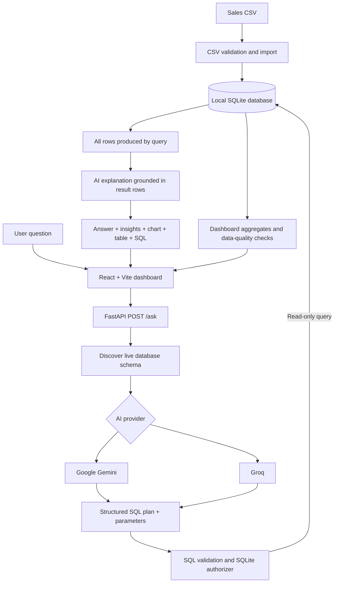

# AI Sales Analyst — Natural-Language Sales Intelligence

A full-stack AI-powered sales analytics application that lets users explore sales data by asking questions in natural language. Instead of choosing from a fixed list of reports, a user can ask questions about the fields available in the SQLite database. The application uses an AI model to prepare a SQL query, validates that query, executes it locally in read-only mode, and presents the results as an explanation, chart, and table.

> **Assessment deliverables:** source code, setup and execution instructions, architecture, automated tests, and an AI development report are included in this repository.

## 1. Project overview

The application converts a natural-language question into a data-backed analysis:

1. The user enters a question in the React dashboard.
2. The FastAPI backend discovers the current SQLite schema.
3. Gemini or Groq proposes a SQLite `SELECT` query and parameter values.
4. The backend validates the SQL and executes it against the local database in read-only mode.
5. The AI creates a short explanation based on the actual query results.
6. The frontend displays the answer, insights, chart, result table, and generated SQL.

The application can answer questions that are supported by the available tables, columns, and records. It cannot reliably answer questions that require information that is not present in the dataset.

## 2. Implemented features

### AI Analyst
- Accepts open-ended natural-language questions rather than relying on a fixed list of analytics intents.
- Uses live database schema discovery (table names, columns, data types, and foreign-key metadata) to ground query generation.
- Supports questions involving totals, averages, rankings, comparisons, date ranges, product/category/region/channel breakdowns, trends, and other analyses that the data supports.
- Supports follow-up questions by sending a short recent conversation history.
- Shows the generated SQL so the user can inspect how the answer was produced.
- Shows a grounded natural-language explanation and key insights.

### Complete-dataset analysis and results
- Analytical SQL is designed to calculate metrics over all records that match the user's filters—not from a sample of the first 10 or 15 rows.
- The query engine fetches every row produced by the validated query; it does not silently slice the result to a fixed number of rows.
- The result table displays all rows returned by the query.
- A full-table request (for example, “show all transactions” or “show the entire table”) is instructed not to add an arbitrary `LIMIT` or the normal business-quality filter.
- A top-N request (for example, “top 5 products”) returns the requested number of grouped results, while the ranking is calculated from all matching source records.
- SQLite query execution has a progress-handler safety limit to interrupt pathological or excessively expensive queries. This is an execution safeguard, not a fixed 10/15/51-row display limit.

**Important distinction:** a chart or top-N answer may intentionally display a smaller set of grouped results because that is what the user asked for. The underlying aggregation/ranking must still use all relevant source transactions. For extremely large result sets, the AI provider may also impose request/context limits; production-scale deployments should use server-side pagination and summarization strategies.

### Dashboard and data quality
- **Overview:** KPI cards and sales summaries, including revenue, transaction count, average transaction value, and units sold.
- **Monthly analysis:** monthly revenue trend.
- **Regional analysis:** revenue by region.
- **Product and category analysis:** top products and revenue by category.
- **Data Quality:** source row count, excluded row count, and data-health information.
- Retains invalid source rows in SQLite with a `data_quality_issue` explanation so they can be inspected.

### Visual presentation
- Three main destinations: **AI Analyst**, **Overview**, and **Data Quality**.
- Responsive React interface.
- Dynamic bar, line, area, pie, table, and scalar-result presentations based on returned data.
- Expandable generated-SQL section.

## 3. Technology stack

| Layer | Technology | Purpose |
|---|---|---|
| Frontend | React, Vite | Dashboard and user interaction |
| Charts | Recharts | Dynamic data visualizations |
| UI animation/icons | Framer Motion, Lucide React | Interface transitions and icons |
| Backend API | Python, FastAPI, Uvicorn | Request handling and orchestration |
| Database | SQLite | Local sales data storage and querying |
| AI providers | Google Gemini API, Groq API | Natural-language-to-SQL planning and result explanation |
| Validation | Pydantic, Python validation, SQLite authorizer | Request and SQL safety |
| Automated testing | `unittest`, FastAPI `TestClient` | Backend and API tests |

## 4. Architecture



### Main components

- `backend/ai_service.py` — provider selection, SQL-plan generation, and result explanation.
- `backend/query_engine.py` — schema discovery, SQL validation, read-only execution, and chart metadata.
- `backend/database.py` — CSV validation, SQLite import, and database initialization.
- `backend/analytics.py` — deterministic dashboard calculations and data-quality reporting.
- `backend/main.py` — FastAPI endpoints and request orchestration.
- `frontend-react/src/App.jsx` — navigation, AI question flow, answer display, charts, and result table.
- `frontend-react/src/styles.css` — dashboard styling.
- `tests/` — automated tests for the backend, query engine, analytics, and API.

A more detailed request lifecycle and trust-boundary explanation is available in [`docs/ARCHITECTURE.md`](docs/ARCHITECTURE.md).

## 5. Setup and execution instructions

### Prerequisites

- Python 3.10 or later
- Node.js 18 or later and npm
- Internet access for Gemini/Groq API requests
- At least one valid Gemini or Groq API key for AI-powered question answering

### Step 1 — Get the source code

Clone your GitHub repository (replace the URL with your repository URL):

```bash
git clone https://github.com/YOUR_USERNAME/ai-sales-analyst.git
cd ai-sales-analyst
```

### Step 2 — Create a Python environment

```bash
python3 -m venv .venv
```

Activate it:

**Linux / macOS**
```bash
source .venv/bin/activate
```

**Windows PowerShell**
```powershell
.venv\Scripts\Activate.ps1
```

### Step 3 — Install dependencies

```bash
pip install -r requirements.txt
```

### Step 4 — Configure AI provider keys

Copy the example environment file:

**Linux / macOS**
```bash
cp .env.example .env
```

**Windows PowerShell**
```powershell
Copy-Item .env.example .env
```

Open the project-root `.env` file and add your own provider key(s):

```dotenv
AI_PROVIDER=auto
GEMINI_API_KEY=your_gemini_api_key
GEMINI_MODEL=your_available_gemini_model
GROQ_API_KEY=your_groq_api_key
GROQ_MODEL=your_available_groq_model
AI_TIMEOUT_SECONDS=35
```

Provider modes:

| Value | Behaviour |
|---|---|
| `auto` | Tries Gemini first and Groq as fallback when both are configured. |
| `gemini` | Uses Gemini only. |
| `groq` | Uses Groq only. |

Use model identifiers currently available to your provider account. API keys must stay in the backend project-root `.env`; never place provider secrets in React code, frontend `VITE_` variables, screenshots, or Git commits. Commit `.env.example` with placeholders, not `.env`.

### Step 5 — Start the application

**Linux / macOS (one-command startup)**

```bash
chmod +x start.sh
./start.sh
```

The launcher prepares the Python and frontend dependencies, starts FastAPI, waits for its health endpoint, and starts Vite. Press `Ctrl+C` in the launcher terminal to stop the processes.

**Windows**

Run:

```bat
start.bat
```

The batch file opens the backend and frontend in separate terminal windows.

### Optional — Start manually

From the project root, use two terminals.

Terminal 1 — backend:

```bash
python -m uvicorn backend.main:app --host 127.0.0.1 --port 8000 --reload
```

Terminal 2 — frontend:

```bash
cd frontend-react
npm install
npm run dev -- --host 127.0.0.1
```

Open the Vite URL printed in the frontend terminal (normally `http://localhost:5173`).

On first backend startup, the supplied `data/sales_data.csv` is imported into `sales.db` when the database needs initialization.

### Useful local URLs

| URL | Purpose |
|---|---|
| `http://localhost:5173` | React dashboard |
| `http://127.0.0.1:8000/health` | Backend health check |
| `http://127.0.0.1:8000/ai-status` | Configured AI-provider status (does not return keys) |
| `http://127.0.0.1:8000/schema` | Discovered database schema |
| `http://127.0.0.1:8000/docs` | FastAPI interactive API documentation |

## 6. Example questions

- Give me an executive summary of sales performance.
- What is the total net revenue across all valid transactions?
- Show the entire sales transactions table.
- Compare monthly revenue across all regions.
- Which products generated the highest revenue?
- Show the top 5 products by revenue as a pie chart.
- Compare Online and Retail sales.
- Find unusual patterns in the sales data.
- Show transactions with data-quality issues.
- Now show only the South region. *(follow-up example)*

The exact answer depends on the columns and records present in the database.

## 7. API endpoints

| Method | Endpoint | Description |
|---|---|---|
| `GET` | `/health` | Service health |
| `GET` | `/ai-status` | Provider configuration status; secrets are not returned |
| `GET` | `/schema` | Live tables, columns, types, and relationship metadata |
| `GET` | `/dashboard` | Dashboard aggregates |
| `GET` | `/data-quality` | Source and excluded-row summary |
| `POST` | `/ask` | Natural-language analytics |
| `GET` | `/docs` | Interactive API documentation |

Example `/ask` request:

```json
{
  "question": "Which five products generated the most net revenue in the South region?",
  "history": []
}
```

The response includes the answer, insights, returned rows and columns, row count, chart metadata, executed SQL, and the source of interpretation/execution.

## 8. Data handling and business rules

- The source CSV is validated and imported into the local `sales_transactions` SQLite table.
- Source rows with issues are retained and annotated in `data_quality_issue`.
- Normal business-performance questions use valid completed transactions by default (`data_quality_issue IS NULL`).
- Explicit requests to inspect all transactions or invalid/data-quality records are intended to include those records rather than silently applying the normal business filter.
- Net revenue is calculated as `quantity * unit_price - discount_amount`.
- Revenue is not the same as profit. Profit cannot be calculated unless the dataset contains a usable cost field.
- Results and metrics can only be as complete as the source data. The app cannot infer missing fields or facts.

## 9. SQL safety and security

The AI provider proposes a query; it does not connect to or execute SQL against the database. The backend:

1. Accepts only one `SELECT` or `WITH ... SELECT` statement.
2. Rejects write operations, schema changes, multiple statements, and prohibited SQL operations.
3. Uses SQLite parameter binding for filter values.
4. Opens SQLite in read-only mode.
5. Installs a SQLite authorizer to restrict reads to application tables/views and deny writes and prohibited functions.
6. Uses a SQLite query progress handler to interrupt queries that exceed the configured execution-work threshold.
7. Returns the actual executed SQL and result rows to the frontend.

The project `.gitignore` excludes `.env`, local database files, Python caches, virtual environments, and frontend build/dependency directories. Before pushing, verify that no real credentials or private customer data are staged.

## 10. Automated tests

Run the backend test suite from the project root with the virtual environment activated:

```bash
python -m unittest discover -s tests -v
```

The current test suite contains **34 tests**. The tests cover:

- CSV validation and data-quality handling.
- Dashboard metrics and month comparisons.
- Schema discovery.
- Successful local read-only SQL execution.
- Parameter binding.
- Rejection of write queries, multiple statements, and SQLite internal-table access.
- Dynamic `/ask` API responses and invalid request handling.
- AI provider selection and placeholder-key detection.
- Full-table retrieval and removal of an AI-added `LIMIT` for explicit full-dataset requests.

The tests use mocked AI responses where appropriate. They do not make live Gemini or Groq API calls and do not consume provider credits.

## 11. AI tools used and how AI was used during development

### AI tools and services

- **ChatGPT:** used as a development assistant to discuss the architecture, explain implementation choices, help troubleshoot issues, review the project workflow, and improve test/documentation coverage.
- **Google Gemini API:** an optional runtime provider used by the application to interpret a user's question and propose a schema-grounded SQL query, and to explain the executed results.
- **Groq API:** an alternative runtime provider and fallback option for SQL planning and result explanation.

### How AI is used inside the application

AI is used for language understanding and explanation—not as the database or source of truth. The model receives the discovered schema and user question, then proposes SQL. The backend validates and runs the SQL locally. The final explanation is grounded in the rows returned by SQLite. The frontend also displays the result rows and executed SQL so the user can inspect the output.

### How AI was used during development

ChatGPT assistance was used to reason through the React/FastAPI/SQLite flow, clarify SQL and API behaviour, investigate row-limit/display inconsistencies, discuss read-only query safeguards, and organize the assessment documentation. Generated suggestions were checked against the source code and automated tests; they should not be treated as a substitute for understanding or reviewing the implementation.

## 12. Problems encountered and how they were debugged

| Problem encountered | Debugging approach / resolution |
|---|---|
| The AI could add an arbitrary `LIMIT` to a full-table request. | Updated the SQL-planning instructions to reserve `LIMIT` for explicit top-N/sample/range requests and added a full-table request safeguard that removes a trailing model-added limit. Added an automated test for this behaviour. |
| The backend could return more rows than the table visibly showed. | Traced the result path from SQL execution to the React table. The current query engine fetches all rows produced by the query, and the table renders all rows returned by the API rather than slicing to the first 15. |
| AI explanations could be mistaken for the source of numeric truth. | Kept SQLite as the calculation source and instructed the summary model to explain only the executed query result. The response also exposes the rows and SQL for inspection. |
| Invalid source records could distort business metrics. | Added CSV validation and a `data_quality_issue` field. Invalid rows remain available for inspection and are excluded from ordinary completed-sales calculations by default. |
| Provider configuration can fail because of missing/placeholder keys, unavailable model IDs, network errors, or quota limits. | Added provider readiness reporting and Gemini/Groq selection/fallback. The `/ai-status` endpoint reports configuration status without exposing credentials; provider errors are checked through backend diagnostics. |

## 13. What could be improved with one more day of work

1. Add server-side pagination and filters for very large result tables while keeping aggregate calculations over the full matching dataset.
2. Add export of query results to CSV and downloadable analysis reports.
3. Improve prompt-injection and adversarial SQL tests, and tighten the SQL function allowlist further.
4. Add process-level query timeouts, rate limiting, authentication, and per-user authorization before any public deployment.
5. Add clearer query-result metadata for whether a result is complete, grouped, or intentionally top-N.
6. Add more robust handling for very large result sets so AI summaries do not exceed provider context limits.
7. Add frontend integration tests and end-to-end tests for the complete question-to-chart workflow.
8. Add configurable business definitions (for example, return/refund handling and revenue rules) with clear user-facing documentation.

## 14. Source code and Git repository

The complete source code is organized in this repository. After creating your GitHub repository, replace the placeholder URL below with your actual repository URL:

```bash
git remote add origin https://github.com/YOUR_USERNAME/ai-sales-analyst.git
git branch -M main
git add .
git commit -m "Build AI Sales Analyst"
git push -u origin main
```

Before committing, verify that `.env` is ignored and is not already tracked:

```bash
git check-ignore -v .env
git ls-files .env
git status
```

The `git ls-files .env` command should print nothing. Commit `.env.example` with placeholder values, never the real `.env`.

## 15. Repository structure

```text
(repository root)
├── backend/
│   ├── ai_service.py
│   ├── analytics.py
│   ├── database.py
│   ├── main.py
│   └── query_engine.py
├── data/
│   └── sales_data.csv
├── docs/
│   ├── AI_DEVELOPMENT_NOTES.md
│   └── ARCHITECTURE.md
├── frontend-react/
│   ├── src/
│   │   ├── App.jsx
│   │   ├── main.jsx
│   │   └── styles.css
│   ├── package.json
│   └── vite.config.js
├── tests/
│   ├── test_ai_service.py
│   ├── test_analytics.py
│   ├── test_api.py
│   └── test_query_engine.py
├── .env.example
├── .gitignore
├── requirements.txt
├── start.sh
├── start.bat
└── README.md
```

---

**Note for submission:** Review the AI-development section and update it if your actual use of tools differs. Also add your real GitHub repository URL after pushing the code. Never include API keys in the README or repository.
