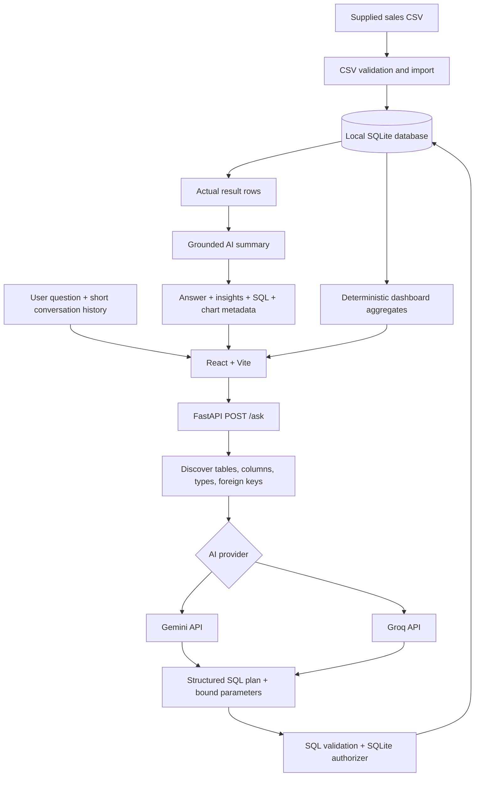

# Architecture — Schema-aware AI Sales Analyst

## Request lifecycle

1. React sends a natural-language question and up to six recent question/answer pairs to `POST /ask`.
2. FastAPI discovers live SQLite table, column, type, and foreign-key metadata.
3. Gemini or Groq receives the schema, business metric definitions, question, and short context. It returns structured JSON containing one SQLite query, bound parameters, and chart hints.
4. The backend validates the SQL shape and opens the local database in read-only mode. A SQLite authorizer rejects writes, schema changes, internal SQLite table reads, and prohibited functions.
5. The query executes on the user's machine. Results are capped and converted to JSON-compatible rows.
6. Gemini or Groq receives the executed SQL and returned rows to produce a grounded explanation and insights. If summarization is unavailable, the raw rows remain visible with a neutral fallback message.
7. React renders the narrative, insights, a dynamic bar/line/area/pie visualization when appropriate, a result table, and expandable SQL.

## Trust boundaries

- Provider keys remain in backend environment variables and are never returned to the browser.
- The model proposes SQL but cannot execute it or connect to SQLite.
- User filter values should be represented as SQLite `?` parameters, not interpolated into SQL.
- Only one read-only query can execute; writes and schema changes are denied by both validation and SQLite's authorizer.
- Queries can read only discovered application tables/views, not SQLite internal tables.
- Normal sales analysis excludes rows with `data_quality_issue`; explicit data-quality questions may inspect those rows.
- The SQL shown in the UI is the statement actually executed by SQLite.
